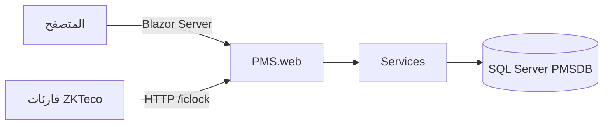

# هيكلية نظام إدارة التصاريح الموحد (PMS)

وثيقة بناء الحل بعد مراجعة الملفات المصدرية وترتيبها، تمهيدًا للنشر على السيرفر.
الواجهة الوحيدة للمستخدم هي **Blazor Server**. الأجهزة والطباعة وبحث الموارد البشرية تبقى نقاط HTTP بجانب الواجهة.

الاتجاه الثابت للاعتماديات:

`PMS.web` → `Services` → `DataAccess` → `Core`

الطبقة الأعلى تعرف الواجهات في `Core` ولا تعرف تفاصيل الجداول. `Services` تنفّذ الواجهات. `DataAccess` هو المكان الوحيد الذي يفتح SQL Server.

---

## 1. مشاريع الحل

| المشروع | الدور |
|---------|--------|
| `Core` | الكيانات، التعدادات، نماذج الشاشات، أكواد الصلاحيات، وعقود الخدمات. لا يعتمد على أي مشروع آخر. |
| `DataAccess` | `DataContext` (EF Core + Identity)، الإعدادات، المستودعات، `UnitOfWork`، وسلسلة الـ migrations. |
| `Services` | منطق العمل: الموظفون، الأجهزة، التصاريح، الاعتماد، التقارير، والبذور الأمنية. |
| `PMS.web` | الاستضافة، Blazor، تسجيل الدخول، التفويض، ومسارات HTTP التي لا تُرسم كصفحات. |

```
PMS.sln
├── Core
│   ├── Entities          الكيانات المخزّنة (موظف، جهاز، تصريح، بوابة، اعتماد)
│   ├── Entities/DTOs     أشكال لا تُخزَّن كجداول (مثل قسم الموارد البشرية)
│   ├── Models            نماذج الشاشات والطلبات
│   ├── Interfaces        عقود المستودعات والخدمات
│   ├── Common            كتالوجات الحالة والنص ومسار الاعتماد
│   ├── Security          أكواد المهام (SystemTaskCodes)
│   ├── Enums / Options
├── DataAccess
│   ├── DataContext.cs
│   ├── Configurations
│   ├── Repositories / UnitOfWork
│   └── Migrations        لا تُحذف؛ هي تاريخ قاعدة البيانات
├── Services
│   ├── Organization      موظفون، صور، بطاقات، أقسام، بوابات، بحث CERPS/HR
│   ├── AccessControl     أجهزة ZKTeco، أوامر، حركة، قوالب حيوية، عمال الخلفية
│   ├── Permits           تصاريح المواد/الزوار/المركبات، التنفيذ، الإشعار
│   ├── Workflow          محرك الاعتماد والإشعارات الحية
│   ├── Security          حسابات، مستويات الدخول، بذرة الصلاحيات
│   ├── Dashboard / Audit
└── PMS.web
    ├── Components        صفحات Blazor والتخطيط والقائمة
    ├── Controllers       مسارات HTTP المتبقية فقط
    ├── Authorization     سياسات المهام
    ├── Identity          مصنع المطالبات وإعادة التحقق
    ├── Hosting           توافق HTTP مع قارئات ZKTeco
    ├── Reporting         PDF الحضور، إكسل، ذاكرة ملفات الطباعة
    ├── Notifications     رسائل الواجهة
    ├── Providers         بيانات المستخدم الحالي
    └── Deploy            سكربتات خدمة ويندوز وجدار الحماية
```

---

## 2. كيف يمر الطلب



1. المتصفح يفتح `/login`. بعد نجاح الدخول تُصدر كعكة Identity، وتُحمَّل مهام المستخدم كمطالبات `pms_task`.
2. `Routes.razor` يرفض أي صفحة بلا تسجيل دخول، إلا إذا كان `DesignMode:DisableAuthentication` مفعّلًا.
3. الصفحة تستدعي واجهة من `Core` (مثل `IEmployeeService` أو `IMaterialPermitService`). الحاوية في `Program.cs` تعطي التنفيذ من `Services`.
4. الخدمة تقرأ وتكتب عبر `IUnitOfWork` أو `IDbContextFactory<DataContext>` حتى لا تتشارك صفحات Blazor سياقًا واحدًا.
5. عند الإقلاع تُطبَّق الـ migrations المعلّقة تلقائيًا، ثم تُلغى أوامر الأجهزة العالقة لأكثر من عشر دقائق.

القائمة في `NavMenu.razor` لا تعرض رابطًا إلا إذا كان لدى المستخدم رمز المهمة المقابل في `SystemTaskCodes`.

---

## 3. الهوية والصلاحيات

- المستخدم هو `Core.Entities.User` ويرث مستخدم Identity. الأدوار القديمة (`Role` / `Permission`) أُزيلت من المصدر لأنها كانت مستبعدة من النموذج ولا يُنشأ لها جدول.
- `SecuritySeedHostedService` يبذر المهام ومستوى دخول أساسي عند الإقلاع.
- `PmsUserClaimsPrincipalFactory` يضع المهام في المطالبة. `TaskAuthorization` يحوّلها إلى سياسات.
- شاشة الدخول Blazor (`/login`) تستدعي `GET /api/auth/gate-required` لمعرفة إن كان المستخدم ضابط بوابة ويجب أن يختار بوابة. الاختيار يُحفظ في الجلسة وفي المطالبة.
- تسجيل موظف من الموارد البشرية يمر عبر `GET /api/hr/employee/{empNo}` ثم `HrEmployeeLookupService`.

---

## 4. المرحلة الأولى — الدخول البيومتري

الشاشات تحت `Components/Pages/Phase1`:

| المسار | الوظيفة |
|--------|---------|
| `/employees` | سجل الموظفين |
| `/employees/register` | تسجيل موظف وصورته وبطاقته |
| `/devices/readers` | تعريف القارئات |
| `/devices/monitor` | مراقبة الاتصال |
| `/access/permissions` | صلاحيات العبور |
| `/movements` | سجل الحركة |

القارئ لا ينتظر أن يتصل به النظام. هو الذي يفتح `http://<عنوان-السيرفر>:5260/iclock`. `ZkTecoPushController` يستقبل `cdata` و`getrequest` و`registry` و`devicecmd`. `ZkTecoHttpCompatibility` يصلح طلبات الجهاز قبل أن يرفضها Kestrel.

الخدمات في `Services/AccessControl` تحوّل ذلك إلى:

- قوالب البصمة والوجه
- أوامر تنزيل المستخدمين على الجهاز (`DeviceCommand`)
- سجل حركة (`MovementLog`)
- حالة الجهاز وأوقات التوقف

عمال الخلفية:

| العامل | عمله |
|--------|------|
| `DeviceCommandWorker` | يرسل الأوامر المعلّقة ويعيد المحاولة |
| `DeviceHealthMonitorWorker` | يعلّم الجهاز غير متصل بعد مهلة `ZkTeco:OfflineAfterSeconds` |
| `ReaderSyncSchedulerWorker` | يعيد مزامنة القارئات حسب الجدول |

---

## 5. المرحلة الثانية — التصاريح

الشاشات تحت `Components/Pages/Phase2` و`Admin` و`Reports`.

تصريح المواد، والزوار، والمركبات يبدأ من صفحة إنشاء. الصفحة تجمع النموذج في `Core.Models` ثم تسلّمه إلى:

- `MaterialPermitService` لإنشاء التصريح وبنوده
- `PermitServices` للعمليات المشتركة على كيان `Permit` (القراءة، تحديث الحالة، ترجمة الرموز)
- `ProcedureMovmentService` لسطر الإجراء (اعتماد، رفض، إرجاع)
- `DepartmentService` لجلب اسم الإدارة من إجراء الموارد البشرية المخزّن، وليس من جدول الأقسام المحلي

`WorkflowEngine` يختار `WorkflowDefinition` النشط لنوع التصريح، ينقل التصريح على `WorkflowStep`، ويحدّث الحالة، ثم `PermitNotifier` يكتب إشعارًا للخطوة التالية أو لصاحب الطلب. `LiveNoticeHub` يوصل الإشعار للواجهة المفتوحة.

تنفيذ التصريح على البوابة (`PermitExecutionService`) يسجّل الدخول والخروج الفعلي. `PermitExecutionMaintenanceWorker` يغلق ما انتهت نافذته.

طباعة تصريح المواد ليست صفحة Blazor. الزر في شاشة العرض يفتح:

`GET /permits/{id}/pdf`

والتنفيذ في `PermitController` يبني PDF (نص عربي + QR) ويرجّعه كملف.

التقارير تُبنى في الصفحة، تُوضع في `ReportFileCache`، ثم تُفتح عبر `GET /reports/print/{id}`.

صفحتان ما زالتا عنصرًا نائبًا وليستا منطقًا مكتملًا: تصريح الموظف (`EmployeePermitCreate`) وتصاريح العمالة (`LaborPermits`). الرابط موجود، والمحتوى رسالة «قيد الإعداد».

---

## 6. ما بقي من MVC ولماذا

أُزيلت شاشات MVC المكررة (دخول، بوابات، مستخدمون، تصاريح، بحث، تخطيط Bootstrap القديم) لأن Blazor يغطيها. ما بقي متعمّد:

| المسار | السبب |
|--------|--------|
| `/login` وصفحات `Components` | الواجهة |
| `/logout` | إنهاء كعكة الدخول والجلسة ثم الرجوع لشاشة الدخول |
| `/error` | صفحة الخطأ في بيئة الإنتاج |
| `/api/auth/gate-required` | اختيار البوابة عند الدخول |
| `/api/hr/employee/{empNo}` | بحث ملف الموظف |
| `/iclock/*` | بروتوكول القارئات |
| `/permits/{id}/pdf` | طباعة تصريح المواد |
| `/reports/print/{id}` | فتح PDF تقرير أُنشئ للتو |

مسار `/legacy/...` لم يعد مسجّلًا.

---

## 7. ما حُذف في المراجعة

- واجهات بلا تنفيذ: `ICarMovment` و`IEquipMatiMovment` و`IPermitType` وخدمتها.
- كيانات كان EF يتجاهلها ولا يستدعيها أحد: `Role` و`Permission` و`UserRole` و`RolePermission` و`ApproveMovment`.
- متحكمات وصفحات ونماذج MVC المكررة، ومكتبات jQuery/Bootstrap المحلية التي لم تعد الصفحة تشير إليها.
- ملفات تجربة وسجلات بذرة (`tmp_parse_test.cs` و`.seed-*.txt`) وملف خيارات فيجوال ستوديو قديم.
- مجلد `PMS.web/Data` الفارغ ومجلد Identity الفارغ.

نُقلت الملفات التي كانت في جذر `Services` إلى مجلد مجالها مع الإبقاء على السلوك:

- `GateServices` و`DepartmentService` → `Services/Organization`
- `PermitServices` و`ProcedureMovmentService` → `Services/Permits`
- مساعدات الطباعة والرسائل → `PMS.web/Reporting` و`PMS.web/Notifications`

لم تُمس جداول `CarMovment` و`EquipMatiMovment`: ما زالت بنود تصريح المواد. لم تُحذف ملفات `Migrations`.

مجلد `_docx_extract` نصوص مستخرجة من وثائق التحليل، وليس جزءًا من البناء. مجلد `Publish` ناتج `publish-server.cmd` وليس مصدرًا؛ أُضيف إلى `.gitignore` مع `bin` و`obj`.

---

## 8. النشر

من جذر الحل:

```bat
publish-server.cmd
```

ينشر إصدارًا مستقلًا لـ `win-x64` إلى `Publish\PMS.Server`. انسخ المجلد إلى السيرفر ثم شغّل `install-service.ps1` كمسؤول. الخدمة اسمها **PMS Web Host**، والمنفذ في إعدادات الإنتاج هو **5260**، وعنوان القارئ:

`http://<IP-السيرفر>:5260/iclock`

تفاصيل الجدار الناري وإعادة التشغيل في `PMS.web/Deploy/DEPLOY.txt`، وتُنسخ مع النشر.

قبل اعتبار النسخة منشورة للإنتاج:

1. `DesignMode:DisableAuthentication` يجب أن يكون `false`. القيمة `true` تفتح الواجهة بلا دخول. راجع `appsettings.Production.json` قبل النسخ.
2. سلسلة الاتصال موجودة داخل ملف الإعدادات. لا ترفع كلمة مرور `sa` إلى مستودع عام؛ على السيرفر يمكن تجاوزها بمتغير بيئة `ConnectionStrings__DefaultConnection`.
3. `Hosting:DisableHttpsRedirection` يبقى `true` طالما القارئات تتكلم HTTP على المنفذ 5260. لا تفعّل التحويل إلى HTTPS إلا إذا وُضع وسيط TLS أمام التطبيق وأُعيد توجيه الأجهزة إليه.
4. التطبيق نفسه يطبّق migrations عند الإقلاع. لا حاجة لأمر `dotnet ef database update` على السيرفر إذا نجح إقلاع الخدمة وظهر ذلك في السجل.
5. أعد البناء بعد هذه المراجعة (`dotnet build PMS.sln -c Release`) قبل تشغيل `publish-server.cmd`، حتى لا تُنشر مخرجات قديمة ما زالت فيها صفحات MVC.

التشغيل المحلي للمراجعة:

```bat
dotnet run --project PMS.web
```
